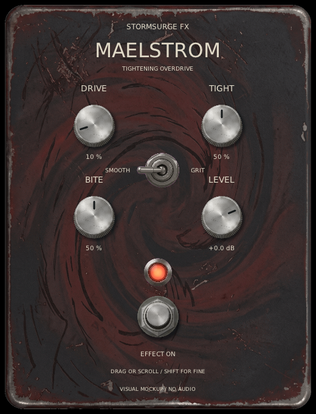

# StormSurge FX

Linux-first, GPL-3.0-only guitar effects for Bitwig and standalone use. StormSurge
now has Undertow, a dark stereo delay, and Maelstrom, a tightening overdrive for
feeding an external amp modeller.

Named after the maintainer's planned song, **StormSurge**. The first musical
milestone is to use Undertow on that track.

| Undertow Preview | Maelstrom |
| --- | --- |
|  |  |
| Dark stereo delay with ping-pong, tempo sync and optional wet-path reverb. | Tightening overdrive interface. The image is a display-only mockup, not a capture of the audio plugin. |

## Status

**Under construction.** Undertow Preview connects the dark-delay core to a VST3 and
JACK-only standalone. It has switchable stereo ping-pong, free-millisecond or
tempo-synced timing, and optional wet-path dark reverb. Reverb starts off to preserve
existing delay projects. See [listening instructions](docs/preview.md). Foundation
remains a separate pass-through plugin for old test projects.
This is a separate project from [Omazone](https://github.com/marrabld/omazone),
not a port of its offline mastering chain.

## First effect: Undertow

A delay for recorded guitar in Bitwig and live playing through an audio interface.
The listening direction is dark, rhythmic repeats and stereo ping-pong, inspired
by the ambience the maintainer enjoys in Devin Townsend's Deadhead. No claim to
reproduce his exact rig or recording. The initial scope is deliberately small:

- Delay time in milliseconds.
- Feedback with bounded settings.
- Wet/dry mix.
- Tone control for darker repeats.
- Output level and bypass with a defined tail policy.
- Stereo plugin I/O; mono channel negotiation and standalone routing remain work.
- Alternating stereo ping-pong and tempo sync for the first playable preview.

The standalone application still needs device selection and input/output metering.
The plugin uses its host's audio devices and transport. Host tail reporting remains
inaccurate, so exports may need explicit trailing silence.

## Second effect: Maelstrom

Maelstrom is a separate overdrive pedal for shaping guitar before an external amp
modeller such as NAM. Tight reduces bass before clipping, Drive controls the amount
of overdrive, Bite shapes the clipped signal's high end, and Level sets the output.
Its optional Grit mode gives a firmer clipping character; Smooth remains the default.
Amp and cabinet modelling, impulse responses and noise gates stay outside StormSurge.

The sound and controls are ready for further listening through the maintainer's
amp-model setup. Numerical tests and a successful build do not establish that it
sounds right, and this README image shows the display-only interface mockup rather
than audio-plugin playback. See [Maelstrom's design and listening plan](docs/maelstrom.md).

## Platforms and formats

- **Linux first**, with Bitwig as the primary DAW for initial host testing.
- **Windows preview builds are available**, using shared DSP and interface code.
  DAW playback and device backends still need testing.
- **Undertow's plugin and standalone** share the same delay implementation.
- C++20, CMake and the ISC-licensed DPF framework are the selected foundation.
  JUCE's current AGPL/commercial terms were reviewed and not adopted. VST3 and
  JACK-only standalone build targets come first. CLAP and LV2 remain later options.
- **macOS experimental preview**: universal Apple Silicon/Intel VST3 and Audio Unit
  v2 builds, targeting macOS 13+. Real Mac DAW playback remains unverified. See
  [Mac tester instructions](docs/macos.md) for format, signing and installation
  limits. No Mac standalone app is included.

## What this is not

No complete pedalboard, amp/cab simulation, plugin hosting, complex routing or
preset marketplace is promised for the first release. Additional effects will
be chosen because the maintainer wants to play through them, not to fill a list.

For live electric guitar, use a suitable instrument input and begin at low
monitoring volume. Avoid accidentally monitoring both the interface's direct
signal and a delayed software copy. Recording latency depends on the complete
audio path; an effect's delay-time knob is a separate thing.

## Build and try it

See [build instructions](docs/building.md) and the [technology decision](docs/technology.md).
Use **Undertow Preview** for audible echoes and **Undertow Foundation** for the old
pass-through experiment. Standalone requires JACK-compatible routing and starts
muted until monitoring is explicitly enabled. Device selection and finished
standalone usability are not implemented yet.

Undertow's cross-platform **experimental plugin preview** is available as
[v0.4.0-preview.1](https://github.com/marrabld/stormsurge-fx/releases/tag/v0.4.0-preview.1).
It contains Undertow Preview builds for Linux x86_64 and Windows x86_64 VST3, plus
macOS universal VST3/AUv2, with matching source and checksums. Maelstrom is not in
that release. See [installation and compatibility limits](docs/install-preview.md).
Windows DAW playback and Dom's Mac test remain unverified; CI is not listening
evidence. Standalone is not in these initial plugin-only downloads.

To view the pedal face without opening any audio device:

```sh
cmake --preset linux-debug && cmake --build --preset linux-debug
./build/linux-debug/preview_gui --view
# Maelstrom's display-only visual mockup, not the audio plugin:
./build/linux-debug/maelstrom_mockup --view
# Legacy pass-through editor:
./build/linux-debug/foundation_gui --view
```

No automatic installation, live-input monitoring or release publication is part of
the build. The maintainer has checked Foundation loading, clean recorded playback
and project reopening in Bitwig Studio Producer 6.1.3 on Omarchy, followed by audible
basic Preview controls, bypass spillover and saved-setting reopening. The new
ping-pong mode also passed listening/reopen checks, and tempo sync had a successful
first host check. The maintainer also approved the reverb sound and checked its
bypass spillover and saved settings. Other hosts/platforms still need testing.
Local Gemini originals remain unchanged. Preview now embeds an approved prepared
enclosure texture; labels and controls are drawn separately. See [artwork provenance](assets/SOURCES.md).

## Next steps

See the [roadmap](ROADMAP.md) and [design questions](docs/design.md).
The roadmap links five ordered GitHub issues for design, build foundations,
delay DSP, playable integration and preview validation. `docs/design.md` separates
approved basic-delay behaviour from remaining integration proposals.

The tested basic core from issue #3 is connected in a first integration slice of
issue #4. Ping-pong is tracked by issue #11 and tempo sync by #13. Host tail reporting
and standalone usability remain work.
The optional reverb experiment is tracked separately in issue #16, not an exact
reproduction of the listening reference or the whole proposed multi-effect chain.
Publishing a release is not authorised. Listening reports are welcome.

## Working on this

[AGENTS.md](AGENTS.md) holds the rules for AI assistants: build commands, test
facts, safety invariants and licensing requirements. [HANDOFF.md](HANDOFF.md) is a
short brief for picking up the project in a new session.

## Licence

Copyright contributors. Project material is licensed under **GPL-3.0-only**.
See [LICENSE](LICENSE). Future dependencies must be reviewed separately for
compatibility, notices and redistribution requirements. Using an effect does not
place your recordings or songs under the GPL.
