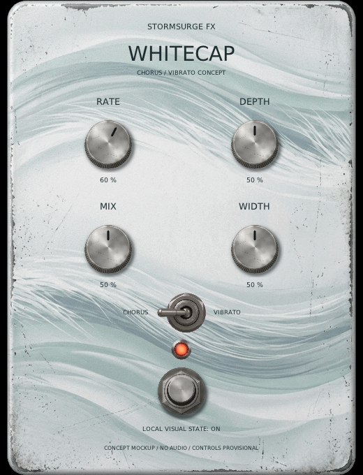
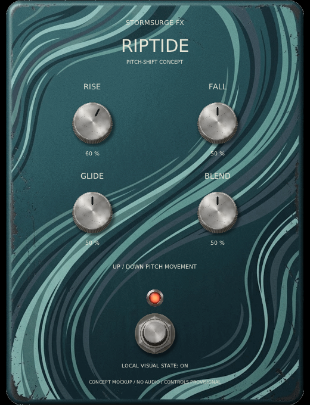

# Whitecap and Riptide concept mockups

These display-only concepts use the maintainer-approved enclosure artwork to
compare the two finishes and try provisional control layouts. They do not process
audio, send host edits or establish plugin identities, parameter schemas or sound
behavior.

| Whitecap | Riptide |
| --- | --- |
|  |  |

The Whitecap toggle and four knob labels are visual proposals, not a decision to
combine chorus and vibrato or to include a stereo-width control. Riptide's Rise,
Fall, Glide and Blend labels are also placeholders; pitch range, control gesture,
return behavior and note-tracking goals remain open. See the design discussions in
[issue #38](https://github.com/marrabld/stormsurge-fx/issues/38) and
[issue #39](https://github.com/marrabld/stormsurge-fx/issues/39).

## Build and view

```sh
cmake --preset linux-debug
cmake --build --preset linux-debug --target future_pedal_mockup
build/linux-debug/future_pedal_mockup whitecap --view
build/linux-debug/future_pedal_mockup riptide --view
```

The mockups need a display and OpenGL context. Without `--view`, each mode checks
that its artwork loads, exercises local knob/footswitch behavior, checks geometry,
renders 30 frames and exits. `--small` repeats at the 390x510 minimum size. All
state is local to the mockup; it is not saved.

See [artwork provenance](../assets/runtime/FUTURE-PEDALS-NOTICE.md). The prepared
images are used only by this concept harness, not by Undertow or Maelstrom plugins.
