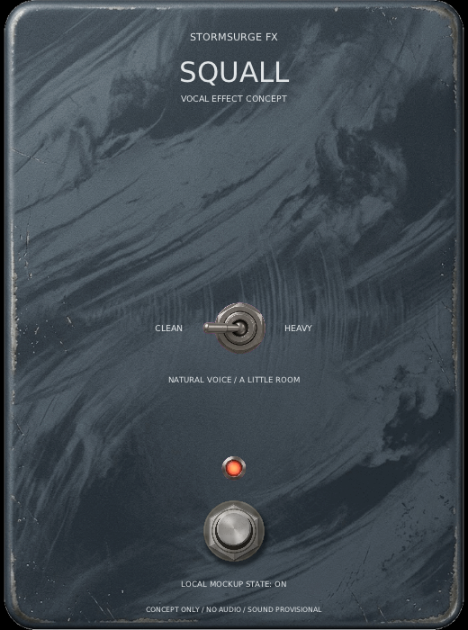

# Squall concept mockup

Squall is a proposed clean/heavy vocal effect. This display-only mockup visualizes
the idea from [issue #48](https://github.com/marrabld/stormsurge-fx/issues/48)
and uses the approved enclosure art recorded in
[`assets/runtime/SQUALL-NOTICE.md`](../assets/runtime/SQUALL-NOTICE.md).

The Clean/Heavy selector and footswitch change local display state only. The
mockup opens no audio device, sends no host edits and contains no vocal DSP. The
short reverb and blended growl-color descriptions are provisional design notes,
not sound claims.



Build and run it on Linux with a display:

```sh
cmake --preset linux-debug
cmake --build --preset linux-debug --target squall_mockup
build/linux-debug/squall_mockup
build/linux-debug/squall_mockup --small
```

Use `--view` to leave the window open for inspection. Use
`STORMSURGE_CAPTURE=/absolute/path.ppm build/linux-debug/squall_mockup --snapshot`
to save the initial view. CI checks the normal and minimum sizes under Xvfb.
