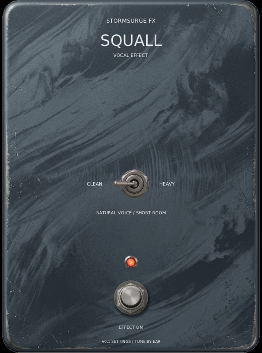

# Squall DSP core

Squall is a proposed vocal effect tracked in [design issue #48](https://github.com/marrabld/stormsurge-fx/issues/48),
[DSP issue #52](https://github.com/marrabld/stormsurge-fx/issues/52) and
[VST3 preview issue #54](https://github.com/marrabld/stormsurge-fx/issues/54). Its
DSP core is host-independent. The VST3 preview adds a separate plugin identity and
simple editor for private listening to recorded vocals.

## Agreed direction

- Clean keeps the natural voice and adds a subtle, short room/plate-style reverb.
- Heavy is for a growl the singer already makes. It should thicken and control the
  sound while keeping words clear, not turn clean singing into a growl.
- Both modes share the same reverb, so mode selection changes vocal color without
  changing the sense of space.
- The first control plan is effect bypass plus Clean/Heavy selection. There are no
  continuous controls in this core.
- No pitch shifting or compression is included in this first pass. Compression may
  bring breaths and harsh vocal noise forward, so it needs evidence from listening.
- The maintainer chose a VST3 effect for recorded vocals as the first listening
  target. The preview targets Linux and Windows only; it does not add standalone
  audio-device support or a macOS plugin.

## Provisional DSP starting points

These are implementation starting values, not approved final settings. There has
not yet been private vocal listening through the DSP.

- Reverb uses four parallel feedback delay lines per channel, two short diffusers,
  a nominal 0.45-second decay and a 12% wet blend. Stereo channels use different
  delay lengths.
- Heavy applies an 85 Hz high-pass and a shallow 12% cut across the 180-420 Hz
  band before a soft saturation curve. It blends 40% of that curve with the
  filtered voice.
- Saturation, EQ and reverb values should be judged with recorded clean voice and
  real growls at matched loudness. Numerical tests do not establish musical quality.

The core accepts planar mono or stereo float buffers. A mono signal remains mono;
stereo input is processed per channel with modestly decorrelated reverb. Parameter
and bypass transitions ramp over 20 ms. `prepare()` allocates the reverb buffers
off the audio callback.

## VST3 listening preview

Build the Linux VST3 bundle with:

```sh
cmake --preset linux-debug
cmake --build --preset linux-debug --target Squall-vst3
```

The bundle is at `build/linux-debug/bin/Squall.vst3`. The project does not install
it. Add it to a VST3 directory Bitwig scans and rescan plugins to audition it.
Build and loader tests do not prove playback or establish that the provisional
settings sound good. The maintainer's private vocal listening check is outstanding.
The plugin advertises stereo I/O; although the DSP core also accepts mono buffers,
Bitwig's handling of a mono vocal track with this stereo VST3 bus still needs checking.
The short reverb tail and offline-render tail behavior also need a host listening check.

The editor harness uses the same layout without opening an audio device:

```sh
build/linux-debug/squall_gui
build/linux-debug/squall_gui --small
STORMSURGE_CAPTURE=/tmp/squall-vst3-editor.ppm build/linux-debug/squall_gui --snapshot
```



This is a no-audio harness capture, not a Bitwig screenshot or listening result.

## Checks

```sh
cmake --preset linux-debug
cmake --build --preset linux-debug --target squall_tests
ctest --preset linux-debug -R '^squall_core$' --output-on-failure
```

The tests check reverb response/reset, Heavy mode, mono/stereo processing, mode and
bypass transitions, invalid samples, supported rates, and ordinary C++ allocation
counts during selected processing calls. They do not prove the effect sounds good.
