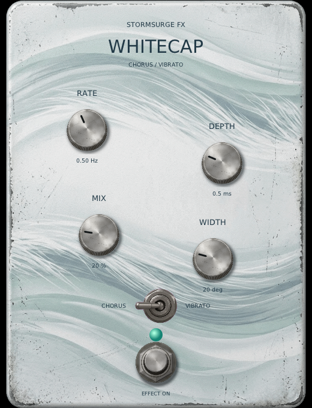

# Whitecap

Whitecap's sound design, host-independent DSP core and initial VST3 listening
preview are tracked in issues [#38](https://github.com/marrabld/stormsurge-fx/issues/38),
[#44](https://github.com/marrabld/stormsurge-fx/issues/44) and
[#46](https://github.com/marrabld/stormsurge-fx/issues/46). Whitecap remains a
separate effect from Undertow and Maelstrom. The DSP core has no host, UI, device
or filesystem dependency.

## Musical contract

- Chorus blends the dry signal with a modulated delay return. Vibrato is fully wet.
- New instances default to Chorus. The proposed default sound is gentle, with a
  subtle dry/wet blend and modest stereo motion.
- Rate is intended to move from slow/flowing to moderately quick; extreme wobble is
  not the goal. Depth should range from subtle to clearly noticeable.
- Width affects both modes. Its minimum has coherent left/right movement; larger
  values introduce a modest phase difference between the channels. Mono usefulness
  is a design goal, not a guarantee against every possible phase interaction.
- Parameter and mode changes ramp over 20 ms. A mode change blends into the new
  output rather than leaving an independent long tail.
- The first listening reference is after the amp, but the effect should work either
  before or after an amp model.

## Provisional engineering values

The maintainer approved conservative implementation values as provisional pending
private listening review:

| Control | Initial range | Starting value |
| --- | ---: | ---: |
| Rate | 0.1–5 Hz | 0.5 Hz |
| Depth | 0–2 ms peak modulation around the centre delay | 0.5 ms |
| Chorus Mix | 0–100%, linear dry/wet blend | 20% |
| Width | 0–90 degrees of LFO phase separation | 20 degrees |
| Mode | Chorus / Vibrato | Chorus |

The modulated signal uses a 10 ms centre delay, so it has intrinsic signal delay.
For the first listening preview, Chorus keeps its dry path immediate. Vibrato's
10 ms delay is treated as part of the effect; the plugin reports no fixed latency.
Live guitar monitoring still includes the Vibrato delay. This is not a claim of zero
monitoring latency, and the policy needs review before product integration.

These ranges and values are engineering starting points, not final sound-design
approval or demonstrated listening results. Review them against the private test
passage described in issue #38 before product decisions. Private recordings must
stay out of the repository and release assets.

## VST3 listening preview

The preview targets Linux and Windows VST3 hosts. It does not add a standalone app
or macOS plugin. To build on Linux:

```sh
cmake --preset linux-debug
cmake --build --preset linux-debug --target Whitecap-vst3
```

The bundle is at `build/linux-debug/bin/Whitecap.vst3`. The project does not install
it. To audition it in Bitwig, place that bundle in a VST3 directory Bitwig scans and
rescan plugins. The editor is resizable, with a 390x510 minimum size. The plugin has
not been verified in Bitwig by the build or tests; the maintainer's private listening
check is still outstanding.

The following is a capture from the no-audio editor harness at its defaults, not a
Bitwig screenshot or playback result:



For a display-only editor check without an audio device:

```sh
build/linux-debug/whitecap_gui
build/linux-debug/whitecap_gui --small
STORMSURGE_CAPTURE=/tmp/whitecap-vst3-editor.ppm build/linux-debug/whitecap_gui --snapshot
```

These harness runs check local UI events, host edit gestures and geometry. They do
not process audio or establish Bitwig behavior.

## Core checks

```sh
ctest --preset linux-debug -R '^whitecap_core$' --output-on-failure
```

The numerical test covers centre-delay timing at supported sample rates, Chorus and
Vibrato routing, coherent and widened stereo behavior, a representative mono sum,
parameter/mode smoothing, reset, invalid inputs, and ordinary C++ allocation counts
in selected processing calls. These checks do not establish that Whitecap sounds
good; that requires private musical listening.
